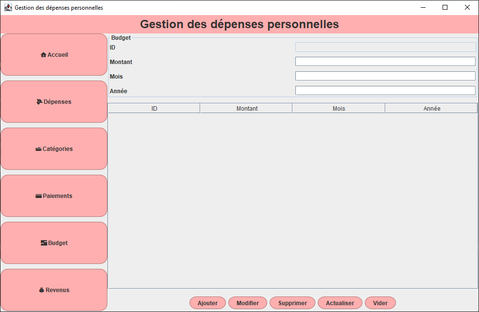
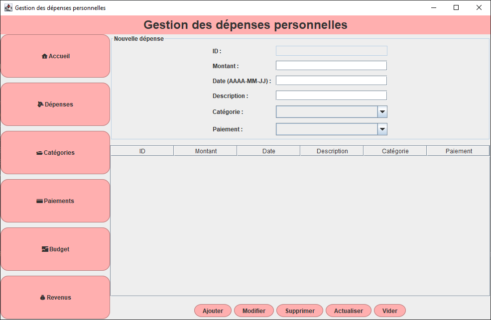
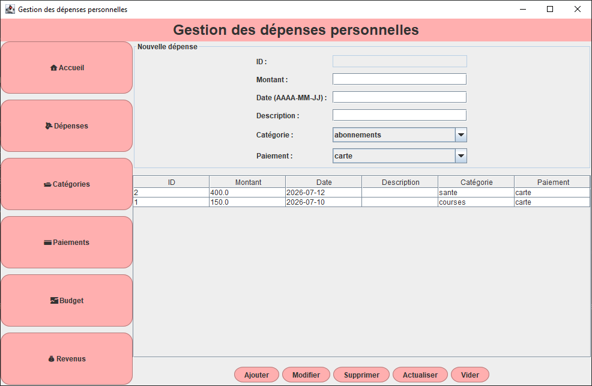
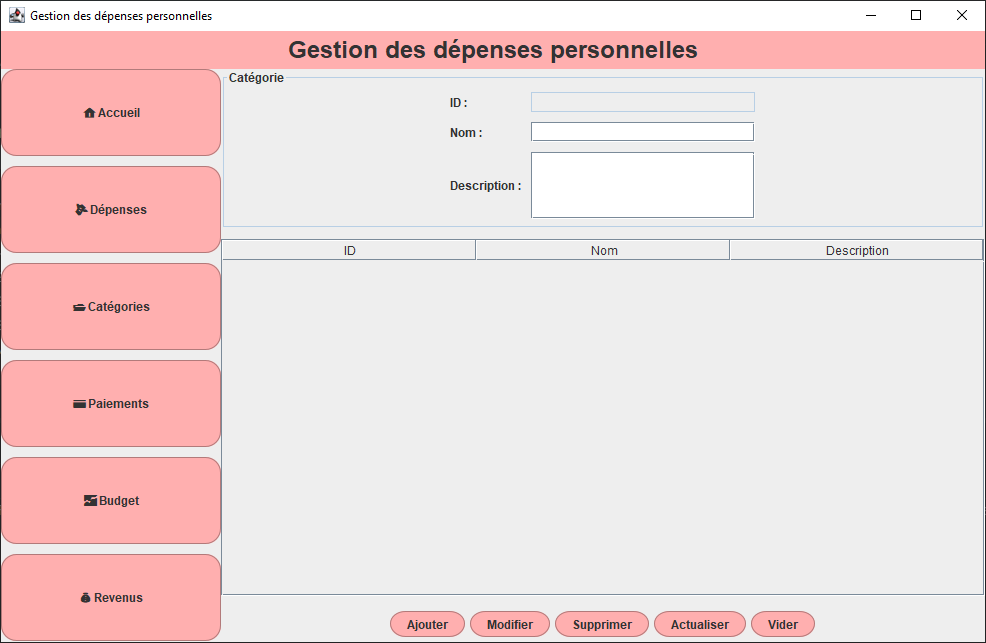
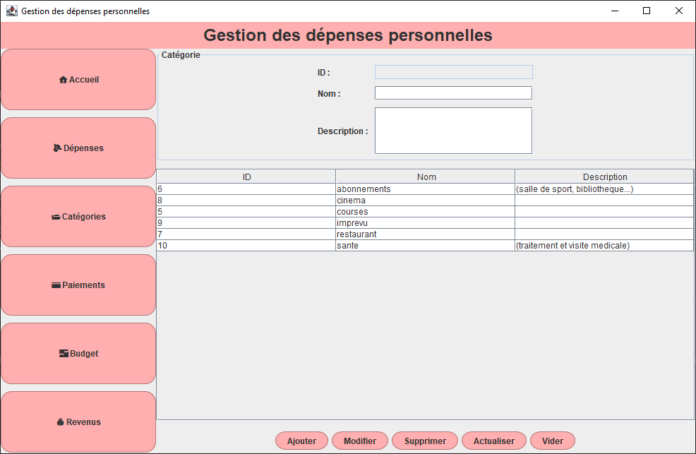
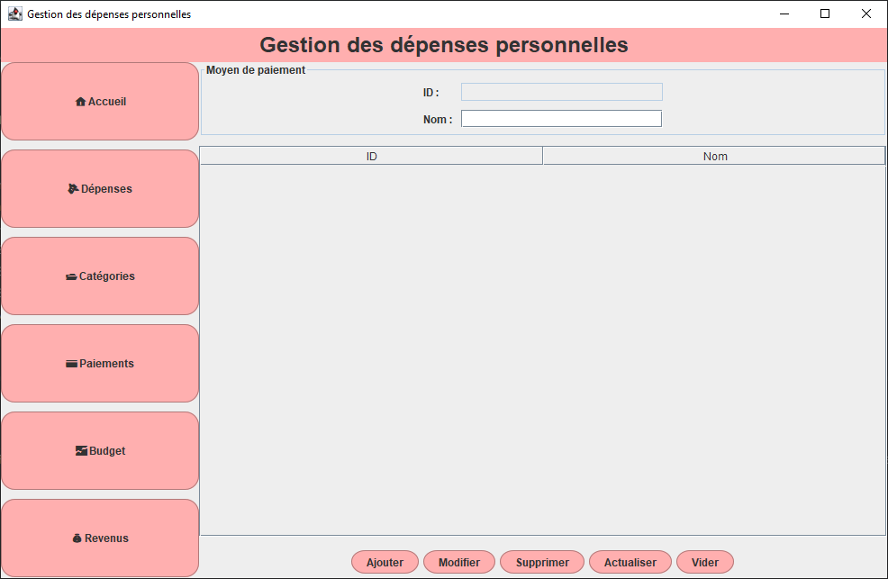
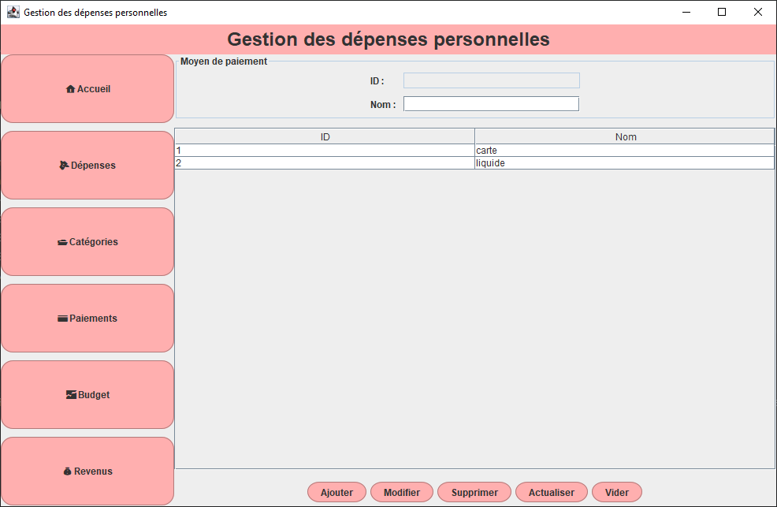
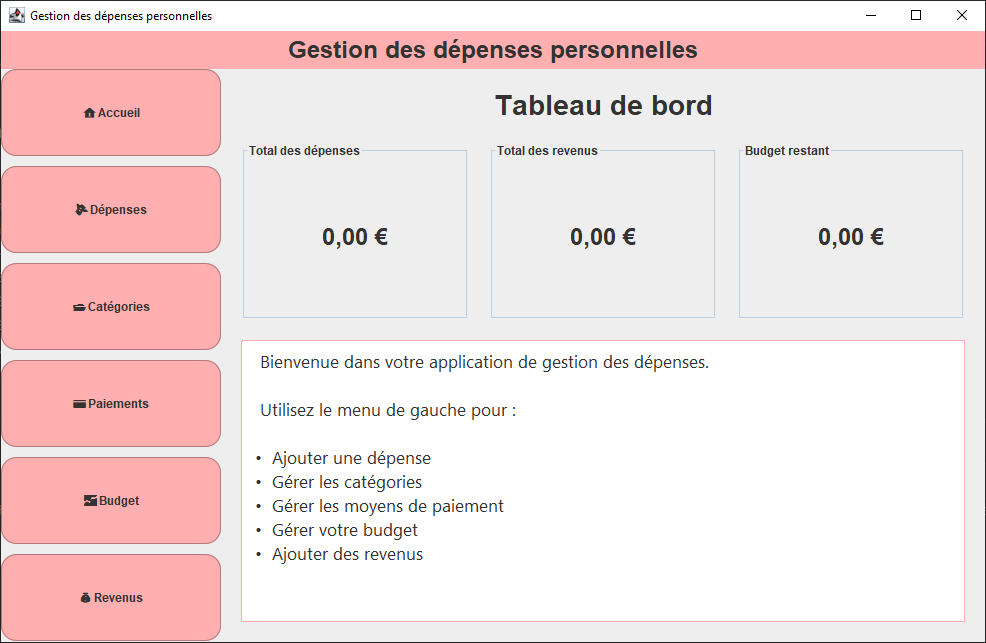
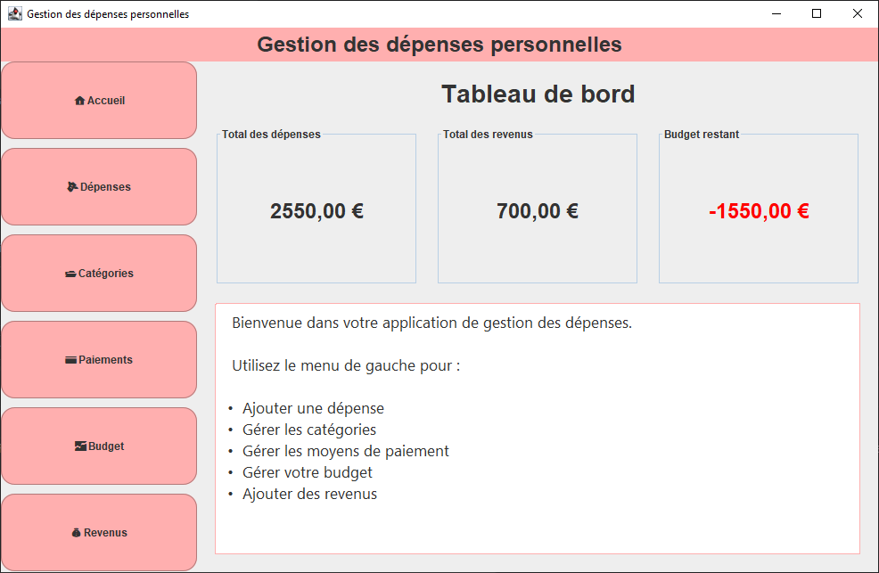

# Gestionnaire de Budget

Une application de bureau développée en **Java Swing** permettant de gérer un budget personnel et de suivre ses dépenses grâce à une interface graphique intuitive connectée à une base de données **MySQL**.

---

# Fonctionnalités

*  Créer et modifier un budget.
*  Ajouter une nouvelle dépense.
*  Modifier une dépense existante.
*  Supprimer une dépense.
*  Organiser les dépenses par catégorie.
*  Gérer les moyens de paiement.
*  Afficher des statistiques sur les dépenses.
*  Calculer automatiquement le budget restant.
*  Afficher une alerte lorsque le budget devient négatif.
*  Enregistrer toutes les données dans une base de données MySQL.

---

# Technologies utilisées

* Java 17
* Java Swing
* JDBC
* MySQL
* IntelliJ IDEA

---

# Base de données

L'application s'appuie sur une base de données relationnelle **MySQL** composée des tables suivantes :

* `budget`
* `depense`
* `categorie`
* `moyen_paiement`
* `revenu`

Ces tables sont reliées entre elles afin d'assurer une gestion cohérente et efficace des données.

---

## Tableau de bord et Statistiques

*Interface Principale avec Visualisation des dépenses et de l'utilisation du budget.*

---

## Gestion du budget

*Affichage du budget actuel et du montant restant.*

---

## Liste des dépenses
*Formulaire permettant d'ajouter une nouvelle dépense et Tableau affichant toutes les dépenses enregistrées.*

---

## Gestion des catégories

*Interface permettant d'ajouter et de gérer les catégories de dépenses.*

---

## Gestion des moyens de paiement

*Interface permettant de gérer les différents moyens de paiement.*

---

## Base de données vide

*État de l'application lorsqu'aucune dépense n'a encore été enregistrée.*

---

## Budget négatif

*Exemple de l'alerte affichée lorsque les dépenses dépassent le budget disponible.*

---

# Améliorations futures

* Gestion des revenus.
* Filtrage des dépenses par mois.
* Recherche de dépenses.
* Export des données (PDF/Excel).
* Authentification des utilisateurs.
* Mode sombre.

---

# Installation

1. Cloner le dépôt.
2. Créer la base de données MySQL.
3. Importer le script SQL.
4. Configurer les informations de connexion à la base de données.
5. Lancer le projet.

---

# Auteur

Développé par **Pinguin** dans le cadre d'un projet universitaire afin de mettre en pratique la programmation Java, la programmation orientée objet, le développement d'interfaces graphiques avec Swing, JDBC et la gestion de bases de données MySQL.

