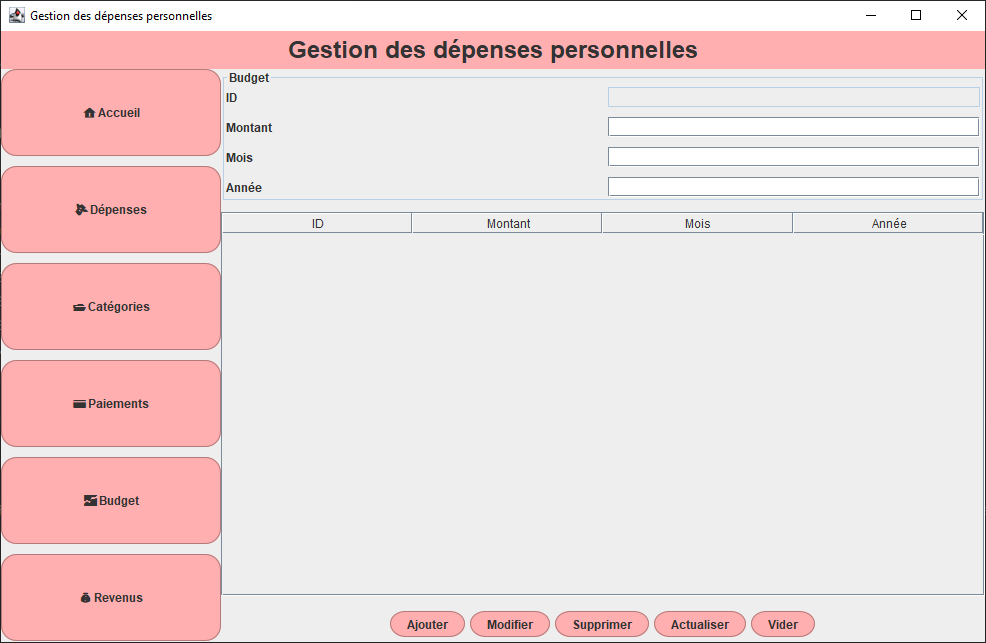
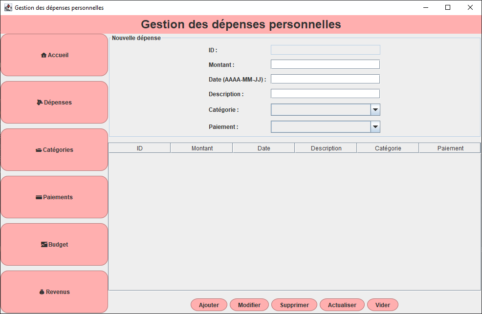
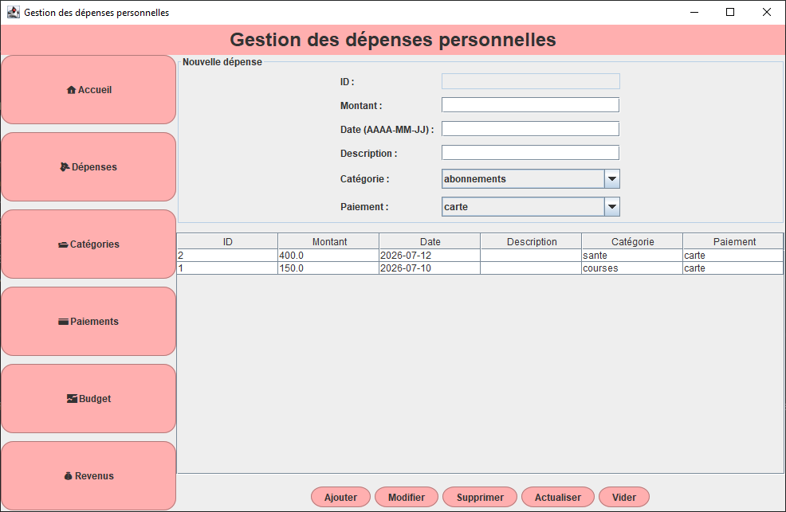
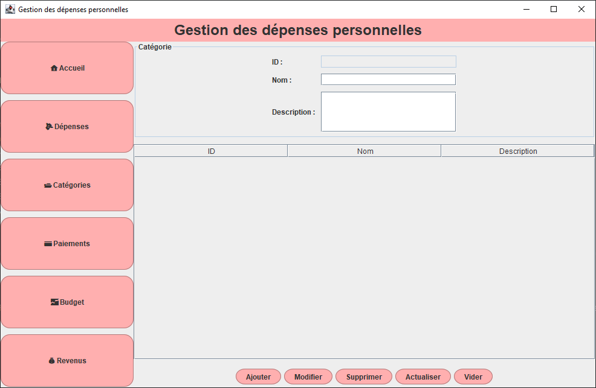
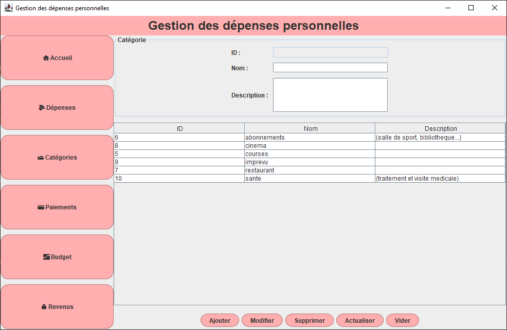
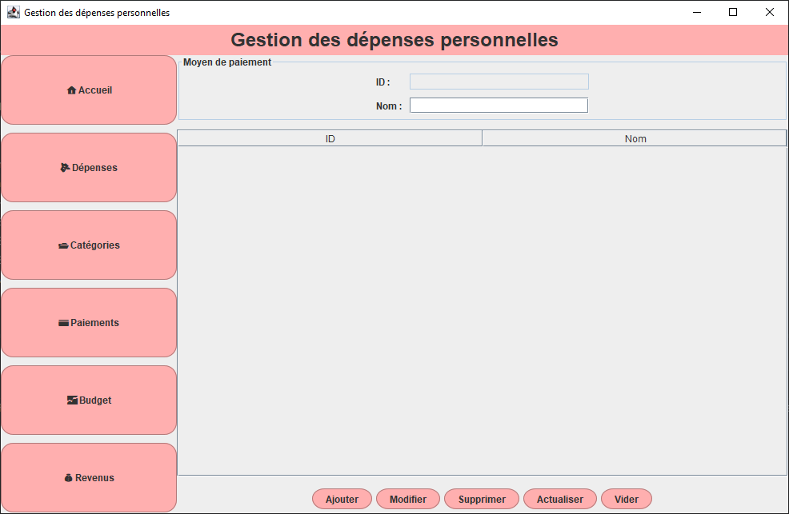
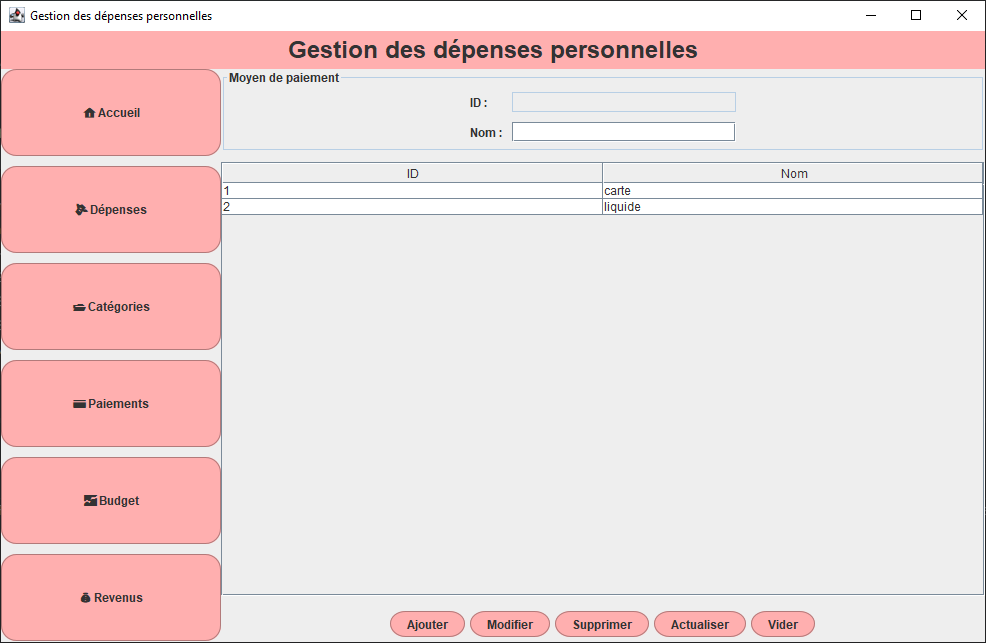
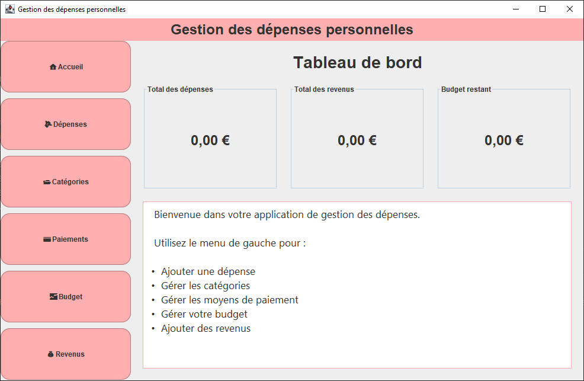
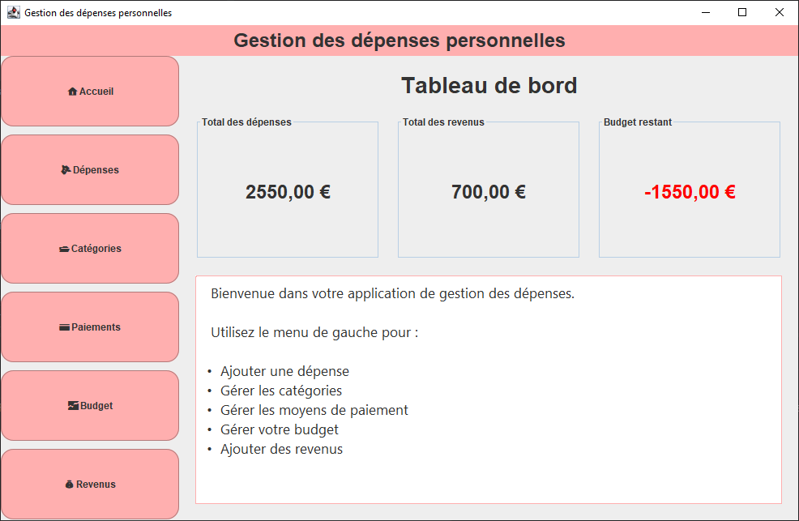

# Budget Manager

A desktop application developed in **Java Swing** that allows users to manage a personal budget and track expenses through an intuitive graphical interface connected to a **MySQL** database.

---

# Features

* Create and edit a budget.
* Add a new expense.
* Edit an existing expense.
* Delete an expense.
* Organize expenses by category.
* Manage payment methods.
* Display expense statistics.
* Automatically calculate the remaining budget.
* Display a warning when the budget becomes negative.
* Store all data in a MySQL database.

---

# Technologies Used

* Java 17
* Java Swing
* JDBC
* MySQL
* IntelliJ IDEA

---

# Database

The application is based on a **MySQL** relational database composed of the following tables:

* `budget`
* `depense`
* `categorie`
* `moyen_paiement`
* `revenu`

These tables are linked together to ensure consistent and efficient data management.

---

## Dashboard and Statistics

*Main dashboard displaying expense statistics and budget usage.*

---

## Budget Management

*Displays the current budget and the remaining available amount.*

---

## Expense Management

*Form for adding a new expense and a table displaying all recorded expenses.*

---

## Category Management

*Interface for adding and managing expense categories.*

---

## Payment Method Management

*Interface for managing different payment methods.*

---

## Empty Database

*Application state when no expenses have been recorded yet.*

---

## Negative Budget

*Example of the warning displayed when expenses exceed the available budget.*

---

# Future Improvements

* Migrate to SQLite to make the application fully portable and easier to install (will be done in another repository soon).
* Filter expenses by month.
* Expense search.
* Export data (PDF/Excel).
* User authentication.
* Dark mode.

---

# Installation

1. Clone the repository.
2. Create the MySQL database.
3. Import the SQL script.
4. Configure the database connection settings.
5. Run the project.

---

# Author

Developed by **DJOUBER Dina** as a personal project to practice Java programming, object-oriented design, Swing GUI development, JDBC, and MySQL database management.

